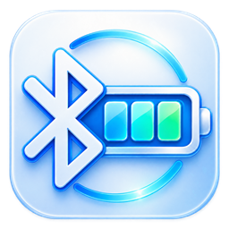
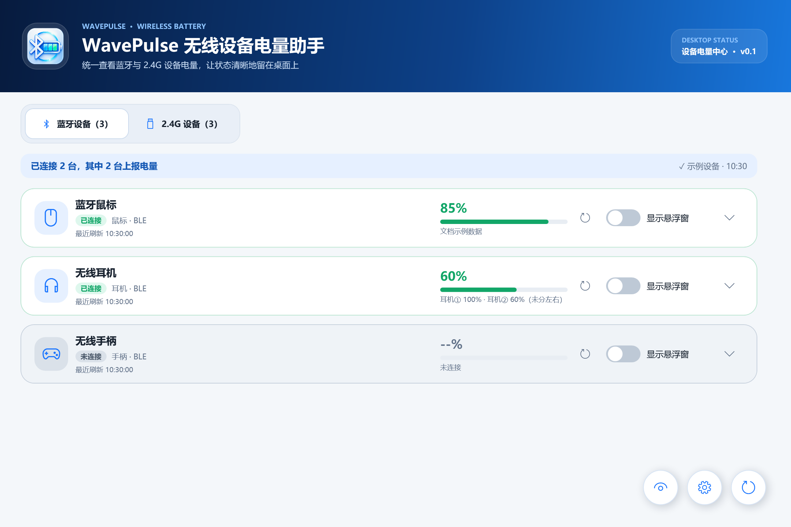
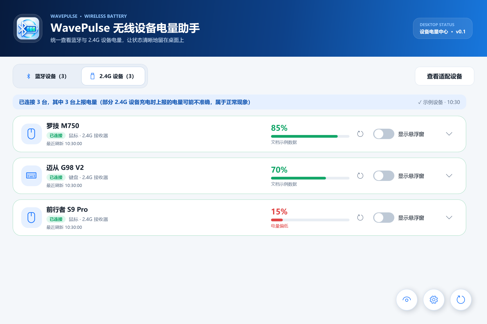
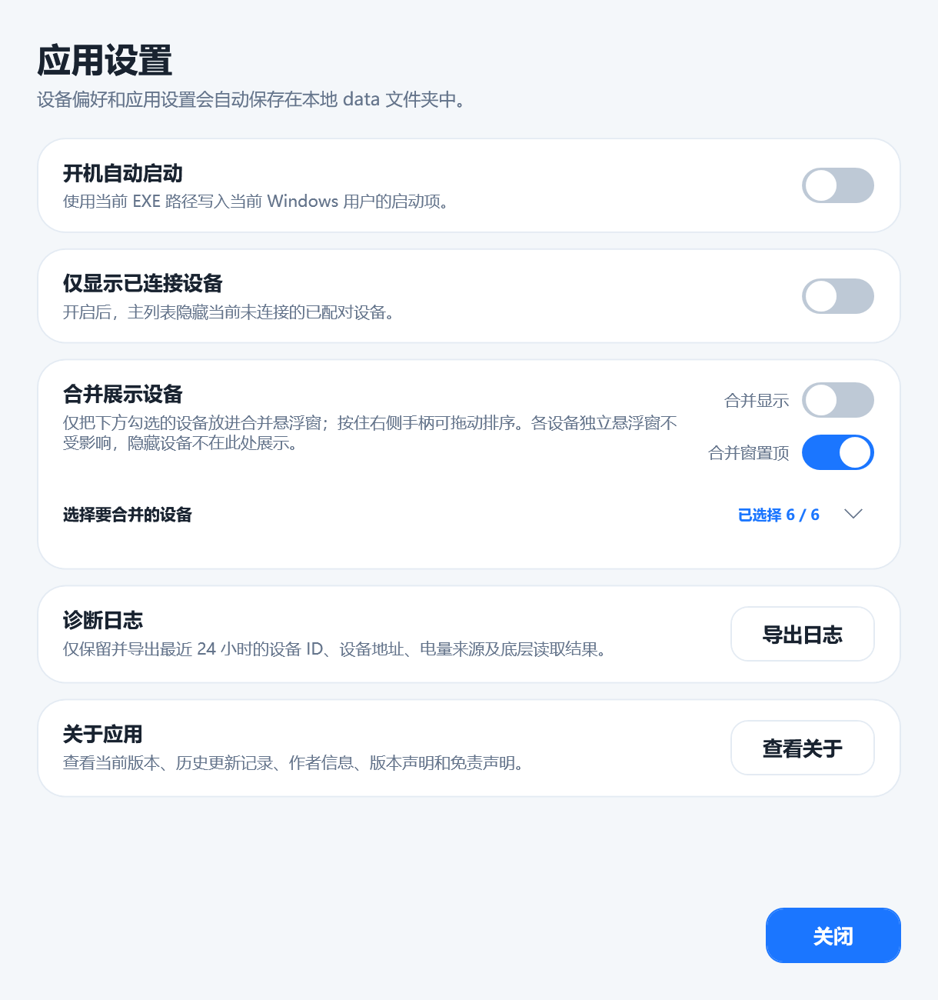
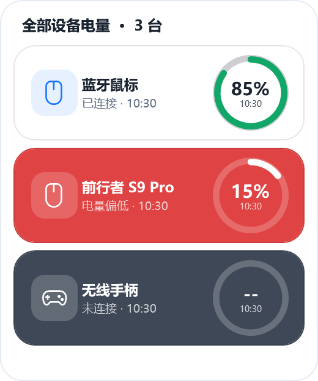

# WavePulse 无线设备电量助手



让鼠标、键盘、耳机和手柄的电量，清晰而安静地留在桌面上。

WavePulse 是面向 **Windows 11 x64** 的无线设备电量工具，支持蓝牙与部分已适配的 **2.4G 接收器设备**。每台设备都可以独立刷新、定制外观，并以单独或合并悬浮窗展示。

**当前版本：v0.1 · 首个公开版本 · .NET Framework 4.8 · 单 EXE 分发**

[下载应用](https://github.com/zhuhan0204/Windows-WavePulse/releases/latest) · [更新日志](CHANGELOG.md) · [使用说明](docs/USER_GUIDE.md) · [反馈问题](https://github.com/zhuhan0204/Windows-WavePulse/issues)

> 普通用户只需下载 EXE 或 ZIP，无需下载源码、SDK 或安装厂商管理软件。

## 界面预览

以下为 v0.1 界面预览，由程序实际 WPF 组件使用示例数据离屏渲染，不是当前电脑的真实设备或电量实测结果。

### 蓝牙设备



### 2.4G 接收器设备



### 应用设置与合并展示



### 桌面悬浮窗



## 主要功能

- **两类设备列表**：切换蓝牙与 2.4G 设备，已连接设备优先显示，离线设备不再显示过期百分比。
- **逐设备刷新**：分别选择 10 分钟、30 分钟、1 小时、3 小时或 5 小时，也可以在设备电量旁或浮窗右键手动刷新；“刷新列表”重新扫描设备列表。
- **设备个性化**：名称最多 20 个字符，支持自动识别或自定义类型、上传图标及恢复内置图标。
- **悬浮外观**：小、中、大或自定义宽高，1–100% 实时透明度，独立的底色、低电量色、离线颜色与低电量阈值。
- **圆环电量**：正常状态显示绿色进度，达到低电量条件后变色，同时展示最近刷新时间；部分耳机可展示多路电量。
- **单独 / 合并悬浮**：勾选合并设备、拖动排序；固定位置、置顶、快速透明度切换、离线保留均可按需设置。
- **多屏定位**：选择目标屏幕并记住相对位置。目标屏幕断开时暂停显示，重新连接后自动恢复，不主动迁移到主屏。
- **隐藏与移除记录**：隐藏设备可在单独窗口恢复；从列表删除的记录可通过重新扫描发现。
- **托盘与后台运行**：关闭主窗口只隐藏到托盘，支持开机后台启动；自启时立即刷新一次，不等待定时周期。
- **本地保存与诊断**：设备偏好保存到本地；诊断日志只保留和导出最近 24 小时。

## 下载与运行

1. 打开 [GitHub Releases](https://github.com/zhuhan0204/Windows-WavePulse/releases)，选择所需版本。
2. 下载 `WavePulse-v0.1-win-x64.exe`，或下载同名 ZIP 后解压。
3. 双击 EXE。蓝牙设备需先在 Windows 中配对；2.4G 设备需插入接收器并唤醒设备。
4. 在设备行开启“显示悬浮窗”。点击设备行空白处可展开详细设置。

运行需要 **Microsoft .NET Framework 4.8 或兼容的更高版本**，不需要 .NET 8。程序不内置运行环境；启动器会先检测环境，缺少时提供官方下载链接和“重新检测”入口。

[微软 .NET Framework 4.8 下载页面](https://dotnet.microsoft.com/zh-cn/download/dotnet-framework/net48)

单 EXE 指分发时只有一个程序文件。运行后会创建本地配置及隐藏运行缓存，不是“完全不落地”的程序。详见 [运行与数据说明](docs/USER_GUIDE.md#数据保存与日志)。

## 设备兼容性

### 蓝牙

按设备情况读取 Windows 电量属性、经典蓝牙耳机 HFP/PnP 属性和 BLE Battery Service。并非所有蓝牙设备都向第三方应用公开电量；休眠、驱动差异和厂商私有协议也可能影响读取。

耳机提供明确的左右耳 / 充电盒属性时，会按属性展示。只有轮换数值、没有左右标识时，使用中性样本标签，不按电量高低猜测左右。双值采样存在时间差，不保证是同一时刻的两耳数值。公开版不包含作者个人耳机地址的专属映射。

### 2.4G 接收器

目前程序内适配目录如下。目录代表已有适配逻辑，不代表覆盖同品牌所有设备、固件或接收器。

| 品牌 | 鼠标 | 键盘 | 说明 |
| --- | --- | --- | --- |
| 罗技 | M750 | — | 通过 HID++ 读取，其他型号可自行测试 |
| Compx | 其他 | — | 按可识别的接收器 / HID 信息读取 |
| 迈从 | — | G98 V2 | TopSpeed 接收器适配 |
| 前行者 | S9 Pro | — | 充电时若百分比不可靠，展示“充电中” |

应用内可按品牌、设备类别和型号筛选适配目录。其他未知品牌可自行测试；未列出的设备不保证支持。部分 2.4G 设备在充电时上报电量不准确，属于设备或固件的上报限制。

## 已知限制

- 多屏断开 / 重连逻辑经过模拟测试，仍需不同显卡、扩展坞和混合 DPI 环境的真实硬件验证。更换接口后若 Windows 将屏幕识别为新设备，需重新选择目标屏幕。
- 刷新时间表示应用最近一次读取的时间，不代表设备刚刚重新测量了电池。
- 自定义宽高范围：160–420 × 56–160；透明度范围：1–100%。
- 源码可见不意味着设备私有协议已统一；发现设备但读取不到电量时，应保留“未上报”状态，不能把历史值当作实时电量。

## 反馈与参与

请在 [Issues](https://github.com/zhuhan0204/Windows-WavePulse/issues) 提供应用版本、Windows 版本、连接方式、品牌型号、预期与实际结果，以及已脱敏的截图。

诊断日志可能包含设备名称、蓝牙地址、USB 标识、序列信息和本机路径。**请勿把完整原始日志直接提交到公开 Issue。** 可先提供相关片段，并删除个人标识；需要完整日志时，请先与作者沟通。

- 作者 / 版权所有人：**yuban**
- QQ 交流群：**560010078**
- Copyright © 2026 yuban. All rights reserved.
- 当前未指定开源许可证，后续授权方式由作者另行确定。

本工具仅展示系统、设备及其驱动上报的状态，不保证电量绝对准确，不替代设备厂商的维护或安全提示。设备商标和型号名称归各自权利人所有；本项目不代表相关厂商的官方产品。

## 从源码构建

当前仅维护 .NET Framework 4.8 版本；旧 .NET 8 工程不纳入公开版本。

```powershell
.\build.ps1
```

需先准备 .NET SDK、NuGet 构建依赖和 64 位 TinyCC。编译工具不会打进发布包。完整步骤见 [构建说明](docs/BUILDING.md)。

源码主要位于 `src/`，原生环境检测入口位于 `native/`，NET48 工程位于 `net48/`。每次公开更新使用新的版本标签及独立 Release，同时更新 [CHANGELOG.md](CHANGELOG.md)；已发布版本不会被静默覆盖。
